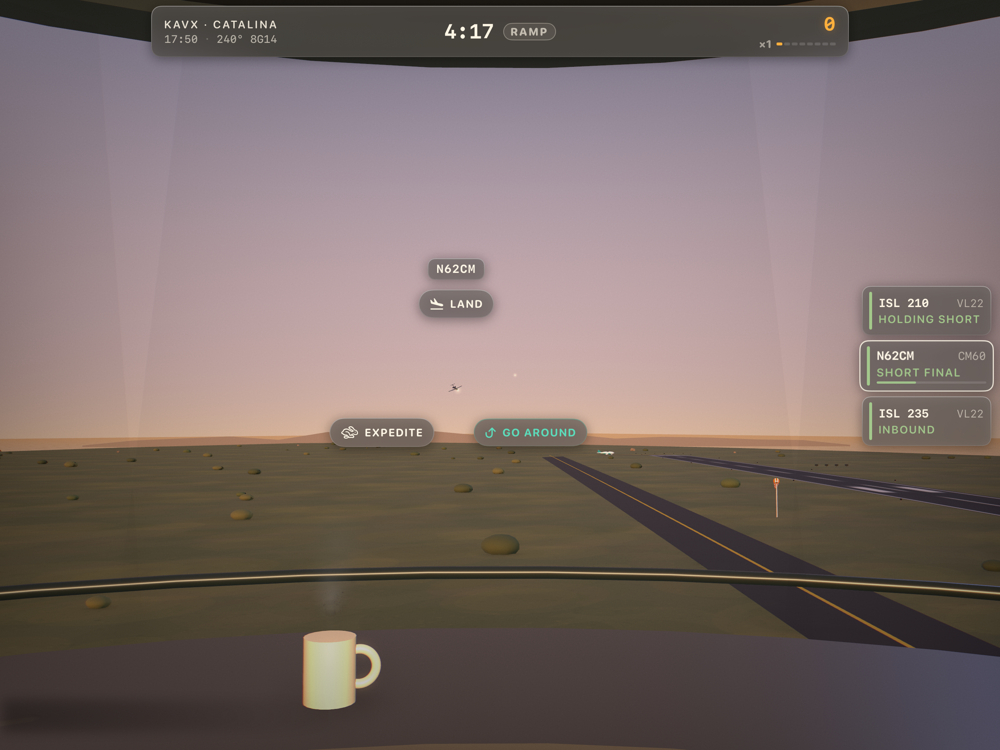
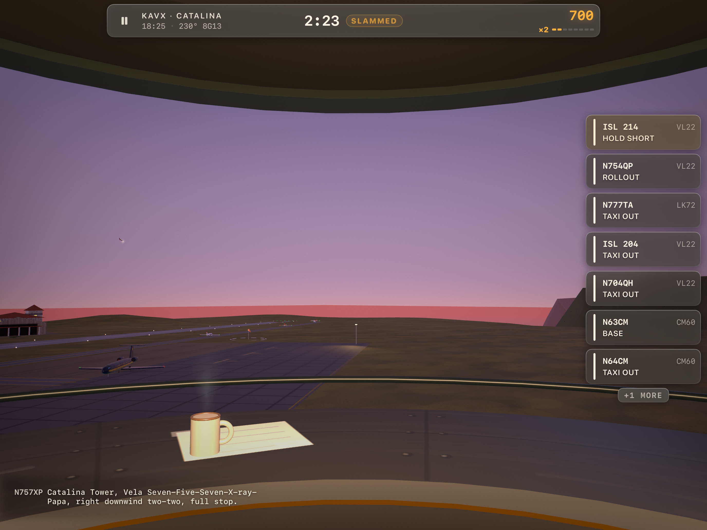
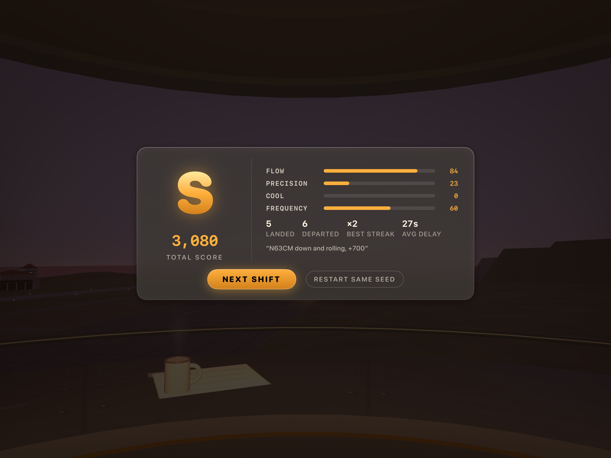

# TowerCab: Slammed

**A 3D air-traffic-control game for iPad.** You're in the tower cab at JFK at golden hour, running a fast arrival and departure rush with a flight-strip rail and a radial menu of touch clearances, chasing tight but safe gaps. Everything you see and hear is generated in code: no models, textures or sound files.

<p>
  
  
  
</p>

*Screenshots are from the earlier Catalina (KAVX) build of the same game.*

## What it does

- **A 7-minute shift.** Traffic builds to a "slammed" crescendo, then a score screen grades you on Flow, Precision, Cool and Frequency.
- **Strips and verbs.** Tap a strip or an aircraft and a radial of the commands that are legal right now opens around it: cleared to land, go around, extend downwind, 360, line up and wait, cleared for (immediate) takeoff, hold position, continue taxi, expedite exit. Swipe a finished strip to hand it off.
- **Gaps are the game.** Each strip shows a gap arc in seconds. Tight gaps in the amber band pay; a go-around on a projected conflict scores a SAVE; sustained red breaks your streak.
- **JFK, to scale.** The Bay Runway (13R/31L, 4,423 m), the crossing runways, taxiways, Terminal City, airfield lighting, Jamaica Bay and a hazy Manhattan skyline.
- **A real-type fleet.** 30 aircraft types modeled to scale; 19 airliners spawn at JFK, from the ATR 72 and Dash 8 to the 747 and A380, weighted like real traffic and flown by fictional airlines.
- **The cab.** Drag to look around, pinch to zoom, double-tap a strip to swing the camera onto that aircraft. A radio log prints each exchange in tower phraseology.

## How it works

- **A deterministic sim, separate from rendering.** `Sim/` is pure Swift (Foundation and simd only) on a fixed 10 Hz tick with a seeded xoshiro256** generator and no wall clock. Input is timestamped and applied on the next tick, and the 60 fps presentation interpolates between the last two ticks, so a seed replays a shift exactly.
- **Headless harnesses.** Because the sim imports no UI frameworks, it compiles on its own for macOS tools: `Tools/simharness.swift` (a competent auto-controller, determinism, neglect, the SAVE table, a separation sweep), `Tools/fuzz.swift` (random legal commands at every aircraft across 120 seeds, asserting no NaN, sane envelopes, termination and determinism) and `Tools/probe-kjfk.swift` (40-seed distributions of touchdown point, runway occupancy, exits and throughput).
- **Procedural world.** `World/` builds the airport, terrain, water, cab interior and every aircraft in SceneKit from code, with a physically based sky driven at accelerated time, so a dusk shift ends in dusk light. A debug assertion in the world builder fires if any paved surface ever sinks below the ground plane.
- **Procedural sound.** `Audio/AudioDirector.swift` runs an `AVAudioEngine` graph: a wind bed that tracks the gusts, an engine voice per aircraft placed in 3D through an `AVAudioEnvironmentNode` that follows the camera, with a doppler shift on flybys, plus radio, touchdown and alarm cues. Sound is off by default and toggles from the start screen or the top bar; the game plays fully silent.
- **Measured tuning.** Each pass is a player-seat audit with measured before and after numbers. Moving touchdown from a fraction of runway length to an absolute band per aircraft size cut the float down JFK's runway from 1,370 m to 344 m and runway occupancy from 89 s to 57 s ([`AUDIT-KJFK.md`](towercab-slammed/AUDIT-KJFK.md), [`AUDIT.md`](towercab-slammed/AUDIT.md)).
- **UI tests through the real gestures.** `UITests/` drives XCUITest through the actual touch layer: start, strip to radial to command, camera pan, score screen, the sound setting, and a reproducible screenshot matrix.

## Tech stack

Swift, SceneKit, SwiftUI (HUD), UIKit, AVFoundation, simd, XcodeGen, XCTest and XCUITest. No third-party dependencies.

## Running locally

Requirements: Xcode 26 or later, [XcodeGen](https://github.com/yonaskolb/XcodeGen), and an iPad Simulator or iPad on iPadOS 17 or later.

```bash
cd towercab-slammed
xcodegen generate              # only needed if you add or remove files
open TowerCabSlammed.xcodeproj  # run the TowerCabSlammed scheme on an iPad, landscape
```

Headless sim checks (pure Swift, no Xcode project needed):

```bash
cd towercab-slammed
swiftc -O -o /tmp/simtest TowerCabSlammed/Sim/*.swift Tools/simharness.swift && /tmp/simtest
swiftc -O -o /tmp/fuzz TowerCabSlammed/Sim/*.swift Tools/fuzz.swift && /tmp/fuzz
```

On a real iPad: `scripts/run-on-device.sh <TEAM_ID>` builds with your signing team and installs to a connected iPad (a free personal team works for a 7-day build).

Debug launch arguments: `-autostart` skips the start screen, `-autopilot` lets a demo controller play, `-seed <n>` fixes the shift, `-ff <s>` fast-forwards, `-hour <h>` pins the sky clock, `-yaw`, `-pitch`, `-fov` and `-campos x,y,z` pose the camera, `-openbloom` opens the radial on the first airborne aircraft, `-hide <names>` hides scene nodes, `-nobloom` turns off camera bloom, `-stats` shows SceneKit stats, `-audiolog` logs the mix level.

## Status

A playable vertical-slice prototype, run on the iPad Simulator. Frame rate and touch feel on a physical iPad haven't been verified yet. Open items, measured in [`AUDIT-KJFK.md`](towercab-slammed/AUDIT-KJFK.md): ground congestion on the single parallel taxiway limits how much traffic a shift can move (one harness assertion is deliberately left failing until that's fixed), the grade is too generous, and the JFK lighting needs a warmer golden-hour grade. Voice commands, weather and a career mode are not built.
